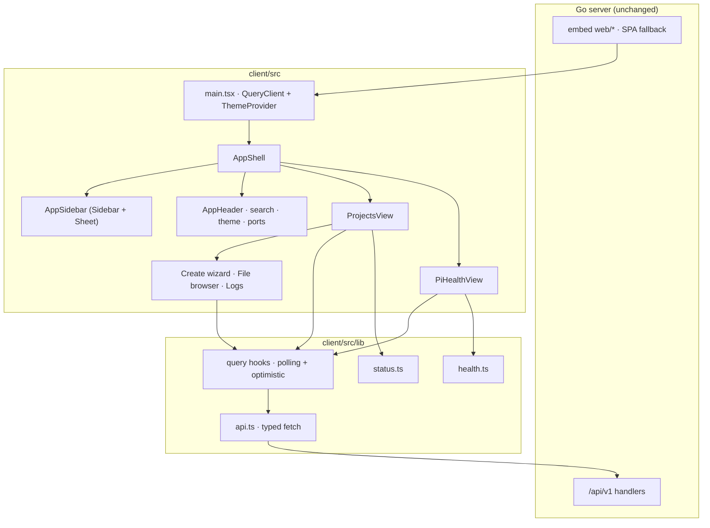
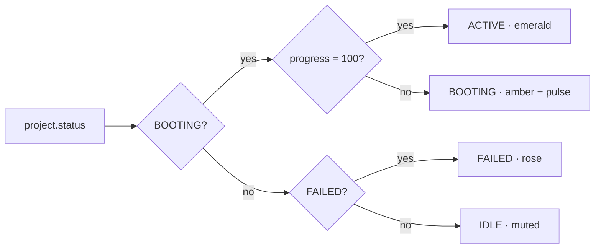

# refactor: Rewrite client in React + shadcn/ui with a premium responsive surface

## Summary

Replace the Svelte 4 client with React 19 + TypeScript + Vite + Tailwind v4 + shadcn/ui, preserving every existing behavior. Rebuild the surface dark-first in a Linear/Vercel register with a persisted light theme, and make it genuinely usable from 360px up: the sidebar becomes a Sheet drawer, the projects table becomes stacked cards, and dialogs become mobile sheets.

---

## Problem Frame

The client is 8 Svelte 4 components (~2,100 lines) with hand-rolled Tailwind markup. Three problems compound:

- `shadcn/ui` is React-only. A Svelte port exists (`shadcn-svelte`), but the team deliberately chose the React ecosystem — Radix primitives, the chart wrappers, and the larger component surface — so the rendering layer has to change framework.
- The UI has no design system. Colors, radii, shadows, and spacing are repeated as literal utility strings inside components, and status colors are duplicated across `App.svelte`, `ProjectCard.svelte`, and `PiHealth.svelte`. There is no token layer, no dark theme, and no shared primitive.
- The layout assumes a desktop. `Sidebar` is a fixed `w-64` column, the projects surface is a six-column `<table>`, and metric panels use fixed widths (`w-56`, `w-48`). Nothing reflows below roughly 1,000px.

The Go backend, the REST contract, and the embed-and-serve pipeline work and are out of scope.

---

## Requirements

**Behavior parity**

- R1. Every API interaction is preserved exactly: paths, methods, payload shapes, and query encoding for `/health`, `/projects`, `/projects/:id`, `/projects/:id/start`, `/projects/:id/stop`, `/fs`, `/pi-health`.
- R2. The projects surface shows id, description, directory path, status with boot progress, port links, and per-row actions (start, stop, logs, delete).
- R3. Start and stop apply an optimistic status change, then reconcile from the server; a failure reverts the optimistic state and surfaces the error.
- R4. The client polls `/health` and `/projects` every 2s and `/pi-health` every 5s, clears timers on unmount, and keeps polling while the window is hidden.
- R5. Create keeps its two steps: details form, then pipeline editor, then a single create request carrying both. The form resets only after a successful create.
- R6. The file browser supports up, home, client-side filtering, directory descent, and selecting the current directory into the path field.
- R7. The log console renders `last_log` in a monospace block and reflects updated logs while the dialog is open.
- R8. Pi health shows hostname, uptime, load averages, four switchable metrics (CPU, memory, temperature, disk), four timeframes (hour, day, month, all), downsampled history, an empty state, and a retry path on error.
- R9. Project search matches id, description, path, and status case-insensitively, with a distinct no-match state.
- R10. The server/client port pills stay visible, and the health-error state remains surfaced.

**Design system**

- R11. The surface is dark by default, honors `prefers-color-scheme` on first visit, persists an explicit choice, and never flashes the wrong theme on load.
- R12. Status is one shared mapping: ACTIVE emerald, BOOTING amber with pulse and boot progress, FAILED rose, IDLE muted. The same mapping drives badges, cards, and controls.
- R13. Typography pairs one sans for UI with one monospace for paths, commands, and logs; numeric metrics use tabular figures.
- R14. Motion is restrained and disabled under `prefers-reduced-motion`.

**Responsive and mobile**

- R15. At 360px wide there is no horizontal page scroll, and the projects table is replaced by stacked cards below 768px.
- R16. Below 1024px the sidebar collapses into a slide-in Sheet driven by a header trigger; all primary actions remain reachable.
- R17. Dialogs become near-full-height sheets below 640px, and interactive targets are at least 44px tall on touch widths.
- R18. Charts fill available width and height without fixed-pixel overflow.

**Tooling and quality**

- R19. `bun run build` emits to `server/internal/api/web`, and the Go binary serves the new bundle with the existing SPA fallback intact.
- R20. `bun run dev` keeps port 2000 with the `/api` proxy to `127.0.0.1:2001`.
- R21. Application code is TypeScript in strict mode, and the production build fails on a type error.
- R22. Vitest + React Testing Library cover the extracted pure logic and the highest-risk components; `bun run test` is the gate.

**Accessibility**

- R23. Every icon-only control has an accessible name, dialogs and sheets trap and restore focus, directory navigation moves focus deliberately, and focus is always visible.
- R24. Text and status colors meet WCAG AA contrast in both themes.

---

## Key Technical Decisions

- **Own the component layer.** shadcn/ui components are vendored into `client/src/components/ui/` via the CLI and edited in place, not consumed as a package dependency. This is the library's intended model and keeps the design system locally auditable.
- **Framework stack.** React 19 + TypeScript + Vite with `@vitejs/plugin-react` and `@tailwindcss/vite`. Tailwind v4 is CSS-first, so `tailwind.config.cjs` and `postcss.config.cjs` are deleted rather than ported.
- **No router.** The two-tab shell (Dashboard, Pi Health) stays component state. Routing adds URL surface the server's SPA fallback does not need and buys nothing this iteration.
- **TanStack Query for the data layer.** It replaces the hand-rolled `setInterval` plus optimistic-mutation code with `refetchInterval`, `onMutate`/rollback optimistic updates, and retry states. Three hooks: `/projects` and `/health` at 2s, `/pi-health` at 5s. `refetchIntervalInBackground: true` is set deliberately so background tabs keep polling as the current `setInterval` does.
- **`/health` keeps its own hook.** It supplies `tailscale_name`, which builds the port links, and the header pills. Folding it into the Pi health query would change the port-link host and the 2s cadence.
- **Recharts via the shadcn chart wrapper for Pi health.** The hand-rolled SVG is replaced by a responsive area chart with tooltips. The Y domain stays pinned per metric (100 for CPU, memory, disk; 85 for temperature) so a 4% reading does not fill the frame.
- **Status and health logic move into pure modules.** `client/src/lib/status.ts` and `client/src/lib/health.ts` hold derivations currently tangled into templates, making R12 and R8 testable without a browser.
- **Theme via a `dark` class on `<html>`.** An inline script in `index.html` resolves stored preference (falling back to system) before first paint; a provider owns toggling and persistence, and also publishes a `data-reduced-motion` attribute so R14 is one testable signal.
- **Two responsive breakpoints, one mechanism.** Layout swaps are conditional renders driven by `matchMedia`, not CSS-only hiding, because duplicate DOM would double the accessibility tree and make the swap untestable. Navigation switches at 1024px (R16); the projects table swaps at 768px (R15).
- **Self-hosted variable fonts.** `@fontsource-variable/geist` and `@fontsource-variable/jetbrains-mono` are bundled rather than loaded from a CDN, because the Pi may have no outbound internet.
- **shadcn Sidebar for navigation, with a breakpoint override.** It provides the desktop rail, collapsed state, and mobile Sheet, so R16 needs no bespoke drawer. Its vendored `use-mobile.ts` hardcodes 768px and must be edited to 1024px, with the component's `md:` classes changed to `lg:`.
- **No `react-hook-form`.** The forms are three fields plus a dynamic pipeline array. Controlled state with inline validation is smaller than wiring a form library and a resolver.
- **Toasts and confirmations replace browser dialogs.** `sonner` for transient errors and successes, `AlertDialog` for delete confirmation, removing the `alert()`/`confirm()` calls in `App.svelte`.
- **`emptyOutDir: true` for the build.** With `favicon.png` served from `client/public`, every asset in `server/internal/api/web` is build output. Emptying prevents stale hashed chunks from accumulating in the embedded bundle.

---

## High-Level Technical Design

Component topology. The Go server keeps serving one static bundle and one `/api/v1` surface; only the tree behind `index.html` changes.



Status derivation, which is where the current UI diverges between table and card:



Responsive behavior, one contract applied per surface:

| Surface | < 640px | 640–767px | 768–1023px | ≥ 1024px |
| --- | --- | --- | --- | --- |
| Navigation | Sheet drawer | Sheet drawer | Sheet drawer | Fixed rail, collapsible |
| Projects | Stacked cards | Stacked cards | Table | Table |
| Project actions | Full-width button row | Full-width button row | Inline | Inline |
| Dialogs | Full-height sheet | Centered, tall | Centered | Centered |
| Metric cards | 2-up grid | 2-up grid | 4-up row | Side column |
| Chart | Full-bleed, 220px | Full-bleed | Flexed | Flexed |

---

## Output Structure

```text
client/
├── components.json
├── index.html
├── package.json
├── tsconfig.json
├── tsconfig.app.json
├── tsconfig.node.json
├── vite.config.ts
├── vitest.config.ts
├── public/
│   └── favicon.png
└── src/
    ├── main.tsx
    ├── index.css
    ├── App.tsx
    ├── components/
    │   ├── ui/                 # shadcn CLI output, owned
    │   ├── layout/
    │   │   ├── app-shell.tsx
    │   │   ├── app-sidebar.tsx
    │   │   └── app-header.tsx
    │   ├── projects/
    │   │   ├── projects-view.tsx
    │   │   ├── projects-table.tsx
    │   │   ├── project-card.tsx
    │   │   ├── status-badge.tsx
    │   │   ├── create-project-dialog.tsx
    │   │   ├── project-form.tsx
    │   │   ├── pipeline-editor.tsx
    │   │   ├── delete-project-dialog.tsx
    │   │   └── log-dialog.tsx
    │   ├── files/
    │   │   ├── file-browser.tsx
    │   │   └── file-browser-dialog.tsx
    │   ├── health/
    │   │   ├── pi-health-view.tsx
    │   │   ├── metric-cards.tsx
    │   │   └── health-chart.tsx
    │   ├── theme-provider.tsx
    │   └── empty-state.tsx
    ├── hooks/
    │   ├── use-media-query.ts
    │   ├── use-projects.ts
    │   ├── use-health.ts
    │   └── use-pi-health.ts
    ├── lib/
    │   ├── api.ts
    │   ├── status.ts
    │   ├── health.ts
    │   └── utils.ts
    └── test/
        └── setup.ts
```

---

## Implementation Units

### U1. Replace the toolchain, initialize shadcn/ui, and stand up the test harness

- **Goal:** A React + TypeScript + Vite + Tailwind v4 project with working tests that builds into the existing embed directory.
- **Requirements:** R19, R20, R21, R22
- **Dependencies:** none
- **Files:** `client/package.json`, `client/vite.config.ts`, `client/vitest.config.ts`, `client/tsconfig.json`, `client/tsconfig.app.json`, `client/tsconfig.node.json`, `client/components.json`, `client/index.html`, `client/src/main.tsx`, `client/src/index.css`, `client/src/test/setup.ts`, `client/bun.lock`, `client/tailwind.config.cjs` (removed), `client/postcss.config.cjs` (removed), `client/src/main.js` (removed)
- **Approach:** Swap `@sveltejs/vite-plugin-svelte` for `@vitejs/plugin-react`; add `@tailwindcss/vite`, `tailwindcss`, `typescript`, `@types/react`, `@types/react-dom`, `vitest`, `jsdom`, `@testing-library/react`, `@testing-library/jest-dom`, `@testing-library/user-event`. Convert the CJS config object to a typed ESM `vite.config.ts` keeping `server.port: 2000`, the `/api` proxy to `127.0.0.1:2001`, and `build.outDir: ../server/internal/api/web`, while switching `emptyOutDir` to `true`. Sequence matters: create `index.css` with the Tailwind v4 import and add the `@` alias to `tsconfig.app.json`, `vite.config.ts`, and `vitest.config.ts` **before** running `bunx shadcn@latest init`, which needs a discoverable entry file and resolvable aliases. `vitest.config.ts` is separate, so it needs its own alias block and `passWithNoTests: true` — Vitest exits non-zero on zero test files, which would fail this unit's own gate. `src/test/setup.ts` stubs `matchMedia`, `ResizeObserver`, pointer-capture methods, and `scrollIntoView`; Radix dialogs and Recharts both require them in jsdom. Add `@fontsource-variable/geist` and `@fontsource-variable/jetbrains-mono`. Scripts: `dev`, `build` (`tsc -b && vite build`), `preview`, `typecheck` (`tsc -b --noEmit`), `test`. Editing the vendored `ui/sidebar` breakpoint happens in U4, not here.
- **Patterns to follow:** Keep the existing proxy target and outDir verbatim; they are the server contract.
- **Test scenarios:** Test expectation: none — toolchain and configuration only. The harness is verified by U3's suite running green.
- **Verification:** `bun run dev` serves on 2000 and proxies `/api` to 2001. `bun run build` succeeds, runs the type checker, and leaves `server/internal/api/web/index.html` plus `assets/` with no files from the previous build. `bun run test` exits zero with no test files and `bun run typecheck` reports no errors.

### U2. Establish the design foundation

- **Goal:** A token-driven dark-first system every later unit consumes, with no flash and no duplicated color literals.
- **Requirements:** R11, R12, R13, R14, R24
- **Dependencies:** U1
- **Files:** `client/src/index.css`, `client/src/components/theme-provider.tsx`, `client/src/lib/utils.ts`, `client/index.html`, `client/src/components/theme-provider.test.tsx`, `client/src/components/ui/sonner.tsx`
- **Approach:** Declare the shadcn token set in `@theme inline` with `:root` (light) and `.dark` (charcoal) values. Status tokens are foreground/background pairs — `--success`/`--success-foreground`/`--success-surface`, and the same shape for `warning`, `danger`, and `muted` — so status colors stop being literals and every pair has a defined contrast partner. Set a tight `--radius` and one elevation scale instead of per-component shadows. Load Geist as sans and JetBrains Mono as mono; enable tabular figures for metric displays. Inline a pre-paint script in `index.html` that reads `localStorage.theme`, falls back to `matchMedia('(prefers-color-scheme: dark)')`, and sets `class="dark"` on `<html>`. The provider exposes `theme`/`setTheme`, persists on change, subscribes to system changes only while the preference is `system`, and sets `data-reduced-motion` on `<html>` from a `matchMedia('(prefers-reduced-motion: reduce)')` listener. Key the global motion-suppression rule and the pulse/glow opt-out off that attribute. Mount `<Toaster />` here so later units only call `toast()`.
- **Patterns to follow:** shadcn theming conventions (CSS variables in oklch, `@theme inline` mapping). No component may reintroduce raw hex values.
- **Test scenarios:**
  - Stored `dark` preference applies `dark` on mount and survives a toggle to `light`.
  - With no stored preference and a mocked `matchMedia` returning dark, the dark class is applied.
  - `setTheme` writes the chosen value to `localStorage`.
  - With `prefers-reduced-motion: reduce` mocked, `<html>` carries `data-reduced-motion="true"`; it is absent or `"false"` otherwise.
  - Test expectation for contrast: none — the named token pairs are checked against WCAG AA in the U9 checklist.
- **Verification:** Toggling the theme recolors every surface without reload, and no `slate-*`/`indigo-*` literals remain in application components.

### U3. Port the API client and build the query hooks

- **Goal:** Typed access to every endpoint, with polling and optimistic mutations owned by hooks.
- **Requirements:** R1, R3, R4, R22
- **Dependencies:** U1
- **Files:** `client/src/lib/api.ts`, `client/src/lib/api.test.ts`, `client/src/hooks/use-projects.ts`, `client/src/hooks/use-health.ts`, `client/src/hooks/use-pi-health.ts`, `client/src/App.tsx`, `client/src/main.tsx`
- **Approach:** Translate `api.js` into typed functions with interfaces for `Project`, `PiHealth`, `HealthResponse`, `FsEntry`, and `PipelineStep`. Preserve the current error shape — a thrown `Error` carrying `status statusText - bodyText` — because R3's error surface depends on it, and preserve the JSON-content-type check that returns text otherwise. Three query hooks: `useProjects` and `useHealth` at 2,000ms, `usePiHealth` at 5,000ms, all with `refetchIntervalInBackground: true`, `refetchOnWindowFocus: false`, and `placeholderData: keepPreviousData`. `useHealth` mounts in `App.tsx` and supplies `tailscale_name` for port links plus the header pill state. Start/stop mutations use `onMutate` to write the optimistic status into the cache, keep a snapshot, and restore it in `onError`; `onSettled` invalidates the projects query. `App.tsx` installs `QueryClientProvider` with retry disabled for mutations and one retry for queries.
- **Patterns to follow:** `client/src/api.js` is the behavioral spec; do not rename endpoints or change payload keys.
- **Test scenarios:**
  - `getHealth` resolves parsed JSON for a 200 JSON response.
  - A 500 JSON response throws an `Error` whose message contains status, status text, and body.
  - A 200 `text/plain` response resolves raw text without attempting JSON parse.
  - `deleteProject` percent-encodes an id containing a slash or space.
  - `createProject` sends the merged project plus pipeline in a single POST body.
  - A failed `startProject` mutation restores the previous project status in the cache.
  - After unmounting a component that uses the projects query, no further requests are issued.
  - `useHealth` exposes `tailscale_name` from a `/health` response.
- **Verification:** No component calls `fetch` directly; every request originates in `lib/api.ts` through a hook.

### U4. Build the app shell and responsive navigation

- **Goal:** The frame every view sits in, usable at 360px and at 1440px.
- **Requirements:** R10, R13, R15, R16, R23
- **Dependencies:** U2, U3
- **Files:** `client/src/App.tsx`, `client/src/components/layout/app-shell.tsx`, `client/src/components/layout/app-sidebar.tsx`, `client/src/components/layout/app-header.tsx`, `client/src/hooks/use-media-query.ts`, `client/src/components/layout/app-shell.test.tsx`, `client/src/components/ui/sidebar.tsx`, `client/src/components/ui/sheet.tsx`, `client/src/components/ui/dropdown-menu.tsx`, `client/src/components/ui/input.tsx`, `client/src/components/ui/button.tsx`
- **Approach:** Wrap the app in `SidebarProvider` with `AppSidebar` (`collapsible="icon"` on desktop) and `SidebarInset`. Edit the vendored `ui/sidebar` `use-mobile` breakpoint from 768px to 1024px and change its `md:` classes to `lg:`, so the nav matches R16 and the responsive table. `AppSidebar` carries the wordmark, the two nav items as active-aware buttons (no router), a primary "Add project" action, and the GitHub link. `AppHeader` is sticky and contains `SidebarTrigger` (the mobile hamburger), a search input that is full-width on mobile and `max-w-md` from `md` up, a theme menu with light/dark/system, and the admin identity block that hides its text below `sm`. The server/client port pills stay in the page-title block beneath the heading, where they live today, so the 360px header is not overloaded. Add `useMediaQuery(query)` plus `useIsMobile()` (768px, for the projects swap) as the single sources for layout swaps. Add a `pointer: coarse` size path to the vendored `button.tsx` and `input.tsx` so touch widths get 44px targets (R17). Content padding goes from a flat `p-8` to `p-4 sm:p-6 lg:p-8` inside a `max-w-7xl` container.
- **Patterns to follow:** shadcn `sidebar` block structure (`SidebarProvider`, `Sidebar`, `SidebarHeader`, `SidebarContent`, `SidebarFooter`, `SidebarMenu`, `SidebarTrigger`, `useSidebar`).
- **Test scenarios:**
  - The active tab renders with `aria-current` and the inactive one does not.
  - With `matchMedia` mocked at 900px, the Sheet trigger renders and the rail does not.
  - With `matchMedia` mocked at 1280px, the rail is present.
  - Typing in the search box calls the search handler; the input is absent on the health tab.
  - Selecting a nav item calls the tab change handler once.
  - The theme menu exposes light, dark, and system entries.
  - Both port pills render at mobile width.
  - Every icon-only header control has an accessible name.
- **Verification:** At 360px the header shows trigger, search, and an icon-only account control with nothing clipped, and both port pills are visible under the page title. At 900px navigation is a drawer. At 1280px the rail is visible and the account block shows name and role.

### U5. Port the file browser and log console

- **Goal:** Both auxiliary dialogs work on the new primitives with the same server contract.
- **Requirements:** R6, R7, R17, R23
- **Dependencies:** U3, U4
- **Files:** `client/src/components/files/file-browser.tsx`, `client/src/components/files/file-browser-dialog.tsx`, `client/src/components/projects/log-dialog.tsx`, `client/src/components/files/file-browser.test.tsx`, `client/src/components/projects/log-dialog.test.tsx`, `client/src/components/ui/scroll-area.tsx`, `client/src/components/empty-state.tsx`
- **Approach:** `FileBrowser` keeps directories-first sorting, up/home controls, filter input, and loading/error/empty states, driven by `getFiles`. Keyboard path: focus the filter on open, give the entry list a roving tabindex with arrow-key movement so it is one tab stop, and move focus to the new path control after each directory change — otherwise every descent unmounts the focused row and drops focus to the dialog. The dialog footer shows the current path and a Choose action that emits the path and closes. `LogDialog` reads `last_log` from the live projects query so the open console tracks polling updates (preserving `App.svelte`'s reactive behavior) and renders in the mono token on a near-black surface. Autoscroll only when the reader is already within a few pixels of the bottom; when they have scrolled up, show a "Jump to latest" control instead of yanking them back every 2s. Below `sm` both dialogs use `inset` sizing so they read as full-height sheets.
- **Patterns to follow:** `FileBrowser.svelte` state handling; `App.svelte`'s log derivation.
- **Test scenarios:**
  - Entries render directories before files, each group alphabetical.
  - The filter narrows entries case-insensitively and shows the empty message when nothing matches.
  - Up from `/home/pi/app` requests `/home/pi`; Up is disabled at root.
  - A failed listing shows the error state and retry re-requests the same path.
  - Choose emits the current path and closes the browser.
  - After descending into a directory, focus is on the path/up control rather than the document body.
  - Arrow keys move the active entry and Enter opens it.
  - The log dialog shows fallback text when `last_log` is empty.
  - With the dialog open, a refetch carrying a longer log updates the rendered text.
  - When scrolled away from the bottom, a log update does not scroll the container.
- **Verification:** Browsing to a nested directory by keyboard and choosing it fills the project path without dismissing any parent dialog.

### U6. Rebuild the projects view with table and card presentations

- **Goal:** One data source, two presentations, one status contract, complete state coverage, and real action feedback.
- **Requirements:** R2, R3, R9, R10, R12, R15, R17
- **Dependencies:** U3, U4, U5
- **Files:** `client/src/components/projects/projects-view.tsx`, `client/src/components/projects/projects-table.tsx`, `client/src/components/projects/project-card.tsx`, `client/src/components/projects/status-badge.tsx`, `client/src/components/projects/delete-project-dialog.tsx`, `client/src/lib/status.ts`, `client/src/lib/status.test.ts`, `client/src/components/projects/projects-view.test.tsx`, `client/src/components/ui/table.tsx`, `client/src/components/ui/alert-dialog.tsx`, `client/src/components/ui/badge.tsx`, `client/src/components/ui/skeleton.tsx`
- **Approach:** `status.ts` exports `deriveDisplayStatus(project)` implementing the state diagram above, plus `statusTone(display)` returning token names and `statusLabel(display)`. `StatusBadge` is the only place tone classes live, and it renders `current_step` and `progress` for BOOTING in both presentations. `ProjectsTable` renders at `md` and up; `ProjectCard` renders below `md` and is the redesigned descendant of the orphaned `ProjectCard.svelte` — id, description, path, ports, boot progress, and a full-width action row. Both consume the same filtered array and the same host from `useHealth`. States are explicitly distinct: loading skeletons, empty (`No projects found` with create action), no-match (with clear action), and error (message plus retry) — a failed fetch must not masquerade as an empty list. Row actions call mutation hooks; a row disables only its own controls while its mutation is pending, which preserves the current global-`busy` guard against double start/stop without freezing the whole table. Delete opens an `AlertDialog`; mutation failures raise `toast.error`, replacing `alert()`.
- **Patterns to follow:** `ProjectCard.svelte` for field order and density; `App.svelte` for optimistic update and delete-confirmation semantics.
- **Test scenarios:**
  - `deriveDisplayStatus` returns ACTIVE for BOOTING at 100%, BOOTING at 42%, FAILED for FAILED, and IDLE for missing or IDLE.
  - BOOTING renders `current_step` and progress in both the table and the card.
  - A port list renders one link per port using the `useHealth` host; an empty list renders the placeholder.
  - Searching a status value filters to matching projects; no matches renders the no-match state and a working clear action.
  - A failed projects query with no cached data renders the error state with a retry, and never the empty-state copy.
  - Clicking start calls the start mutation for that id and the badge shows BOOTING immediately.
  - While a row's mutation is pending, that row's controls are disabled and other rows remain enabled.
  - A rejected start mutation restores the previous badge and raises a toast.
  - Confirming delete calls the delete mutation; dismissing the dialog does not.
  - With `matchMedia` mocked to mobile, cards render and no `table` element exists.
- **Verification:** Desktop and mobile presentations show identical data for the same list, and no status color literal appears outside `status-badge.tsx`.

### U7. Rebuild the create-project wizard

- **Goal:** The two-step create flow in a responsive dialog with the pipeline editor intact.
- **Requirements:** R5, R17, R23
- **Dependencies:** U5, U6
- **Files:** `client/src/components/projects/create-project-dialog.tsx`, `client/src/components/projects/project-form.tsx`, `client/src/components/projects/pipeline-editor.tsx`, `client/src/components/projects/create-project-dialog.test.tsx`, `client/src/components/ui/dialog.tsx`, `client/src/components/ui/label.tsx`
- **Approach:** One `Dialog` hosts a two-step state machine (`details` → `pipeline`). Details collects id, description, comma-separated ports, and path, with Browse opening the U5 file browser. Next is disabled until id is non-empty. The pipeline step seeds the three defaults (`Install`/`bun install`, `Build`/`bun run build`, `Start`/`bun run start`), supports add and remove, and blocks save at zero steps. Back preserves entered details. Save sends one merged payload and closes only on success; fields reset on success, not on cancel. Below `sm` the dialog uses `inset` sizing; the pipeline list scrolls within `max-h-[50vh]`. The mobile relationship between this sheet and the file browser is an open question — the nested-dialog contract described here is the desktop behavior.
- **Patterns to follow:** Step defaults and validation rules from `PipelineEditor.svelte` and `ProjectForm.svelte`.
- **Test scenarios:**
  - Next is disabled with an empty id and enabled once one is typed.
  - `"3000, 3001"` becomes `["3000","3001"]`; `""` becomes `[]`.
  - Browse opens the file browser and the chosen path appears in the path field.
  - Back from pipeline returns to details with values preserved.
  - Save is disabled at zero steps; removing every step reaches that state.
  - A successful save closes the dialog, resets fields, and invalidates the projects query.
  - A failed save keeps the dialog open with values intact and raises a toast.
- **Verification:** Creating a project from a phone-sized viewport completes without the dialog overflowing or the submit button leaving the viewport.

### U8. Rebuild the Pi health view and chart

- **Goal:** Preserve history analysis and metric switching, presented as a premium dashboard that survives narrow screens.
- **Requirements:** R8, R12, R15, R18, R22, R23
- **Dependencies:** U3, U4
- **Files:** `client/src/components/health/pi-health-view.tsx`, `client/src/components/health/metric-cards.tsx`, `client/src/components/health/health-chart.tsx`, `client/src/lib/health.ts`, `client/src/lib/health.test.ts`, `client/src/components/health/pi-health-view.test.tsx`, `client/src/components/ui/chart.tsx`, `client/src/components/ui/tabs.tsx`, `client/src/components/ui/progress.tsx`
- **Approach:** Extract four pure functions into `health.ts`: `filterByTimeframe(history, timeframe, now)`, `downsample(series, target = 300)`, `labelIndices(series, timeframe)`, and `temperatureTone(value)` with the 50/70 thresholds. `downsample` keeps the existing stride sampling and is documented as such — it preserves the first point, does not guarantee the last, and can land just above the target when the length is not a multiple. Host identity cards become token-styled panels rather than three saturated gradients. `MetricCards` is a 2-up grid on mobile and a vertical column from `lg`; selecting a card switches the metric. The metric config keeps its pinned `max` (100/100/85/100) and the chart applies it as `YAxis domain={[0, max]}` with unit tick labels, so a small reading does not stretch to fill the frame. `HealthChart` uses `ChartContainer` + Recharts `AreaChart` with a gradient fill, X labels from `labelIndices`, and a tooltip. Heights are explicit — `h-[220px]` below `sm`, `min-h-[280px]` above — because `ResponsiveContainer` collapses without a sized parent. Timeframes render as `Tabs`, scrollable on mobile. Empty history renders inside the chart frame; the error state keeps its retry. Accessibility: the frame carries `role="img"` with an `aria-label` naming metric, timeframe, latest value, and range, plus a visually hidden summary of min, max, and latest, since the metric cards show only the current value.
- **Patterns to follow:** The existing downsampling step, per-timeframe label rules (5-minute, hourly, midnight, weekly), temperature thresholds, and per-metric Y maxima are the spec.
- **Test scenarios:**
  - `filterByTimeframe` excludes points older than the window and keeps boundary points; `all` returns everything undownsampled.
  - `downsample` reduces a 1,200-point series to at or below 300 and preserves the first point.
  - `labelIndices` yields 5-minute marks for `hour`, hourly marks for `day`, and falls back to first/last when fewer than two labels are found.
  - `temperatureTone` returns danger at 70+, warning at 50–69.9, and success below 50.
  - The chart Y domain is 85 for temperature and 100 for the other metrics.
  - Switching metric changes the chart series binding without a refetch.
  - The hidden summary and `aria-label` update when the metric changes.
  - Empty history renders the empty state instead of an axis with no series.
  - A failed request with no cached data renders the error state and retry triggers a refetch.
- **Verification:** At 360px the metric grid, timeframe tabs, and chart stack without horizontal scroll, and the chart redraws on viewport resize.

### U9. Remove the Svelte surface and run the parity pass

- **Goal:** No dead code, no stale references, and a requirement-by-requirement parity record made while the old UI is still available for comparison.
- **Requirements:** R1–R24
- **Dependencies:** U5, U6, U7, U8
- **Files:** `client/src/App.svelte` (removed), `client/src/tailwind.css` (removed), `client/src/api.js` (removed), `client/src/components/*.svelte` (removed), `client/web-ui/` (removed), `client/README.md`, `README.md`, `start.sh`, `dev.sh`
- **Approach:** Record the parity table below before deleting anything, so the Svelte implementation is still the side-by-side baseline. Then delete the Svelte components, the stray `client/web-ui/src/components/Modal.svelte` duplicate, and leftover Svelte configuration. Update script echo strings that say "Svelte" and the README's frontend stack line and dev URL (it claims port 5173; the Vite config and `dev.sh` use 2000). Make `start.sh` fail fast — `set -euo pipefail`, or `&&`-chained builds — and start the binary only after both the client and Go builds succeed; today a failed client build silently relaunches the previous binary under an "All systems ready!" banner.
- **Parity checklist:** every requirement gets a named check here. Automated rows are covered by the unit tests above; manual rows are walked once against a live backend.

| Requirement | Check |
| --- | --- |
| R1, R3, R4, R5 | U3 and U7 tests |
| R2, R9, R12, R17 | U6 tests |
| R6, R7, R23 (focus) | U5 tests |
| R8, R18 | U8 tests |
| R10 | Manual: both pills visible at 360px; `/health` failure shows the error state |
| R11, R14 | Manual: reload in each theme with no flash; enable reduced motion and confirm the BOOTING pulse stops |
| R13 | Manual: paths, commands, and logs render in the mono face; metric figures align |
| R15, R16 | Manual at 360 / 900 / 1280px: cards then table; drawer then rail; no horizontal scroll |
| R19, R20 | `bun run build` then `go build`, serve the binary, load the UI and hit every API route |
| R21, R22 | `bun run typecheck` and `bun run test` |
| R24 | Manual: contrast-check each declared foreground/surface token pair in both themes |

- **Patterns to follow:** `dev.sh` and `start.sh` build order — client first, then the Go build that embeds it — must not change.
- **Test scenarios:** Test expectation: none — deletion, script hardening, and a manual parity record; behavior is covered by U2–U8.
- **Verification:** `grep` finds no `.svelte` imports, no `lucide-svelte`, and no `slate-`/`indigo-` utility literals in `client/src`. Every checklist row has a recorded pass. A clean `bun run build` followed by `go build` produces a binary that serves the new UI and every API route, and a deliberately broken client build makes `start.sh` exit without starting the server.

---

## Scope Boundaries

**Deferred to follow-up work**

- Real URL routing and deep links per tab.
- CI wiring for `bun run test` and `bun run typecheck`; the repo has no workflows today.
- Automated visual regression or browser testing (Playwright); the parity checklist stays manual this pass.
- Chart interactions beyond tooltips — brushing, zoom, export.
- Any server-side change: handlers, state shape, systemd integration, and the `/api/v1` contract are untouched.
- Virtualized rendering for very long histories; current downsampling is retained.
- Server-side compression. The Go server serves the embed uncompressed today, and adding gzip is a backend change.

**Not in scope**

- Re-theming or restructuring the Pi health data model.
- Authentication or multi-user concepts behind the "Admin User" identity block, which stays static as today.

---

## System-Wide Impact

- **Bundle and binary size.** Adding React, Radix primitives, Recharts, and two variable fonts increases the embedded bundle materially versus Svelte. The Go server serves it uncompressed over the LAN, so the initial JS is capped at 400KB gzipped and measured in U1 and U9; a larger number is a finding, not a surprise.
- **Build coupling.** `start.sh` builds the client before `go build`, so a client failure now fails a Go build for a different reason. `emptyOutDir: true` makes the embed directory purely derived, and the fail-fast change in U9 stops the script from relaunching a stale binary.
- **Developer entry points.** `bun run dev` keeps port 2000 and the same proxy, so muscle memory and the corrected README agree.
- **No runtime backend impact.** Polling cadence, request volume, and endpoints are unchanged; TanStack Query issues the same requests at the same intervals, including in background tabs.
- **Build output is tracked.** `server/internal/api/web/index.html` and `favicon.png` are committed, so every client build produces a diff there. That is pre-existing behavior and is left as is.

---

## Risks & Dependencies

- **Tailwind v4 divergence from v3 habits.** Syntax the current markup relies on in spirit (`class:` directives, config-based content globs) does not translate. Mitigation: every component is rewritten in React, so no mechanical port is attempted; tokens live in CSS.
- **shadcn CLI assumptions.** The CLI expects alias configuration and a discoverable Tailwind entry file, which is why U1 orders those before `init`. If `init` still misdetects the layout, `components.json` is corrected by hand and generated imports are checked to resolve under `@/`.
- **Recharts on a constrained device.** Rendering happens in the viewer's browser, not on the Pi, so the risk is bundle weight rather than Pi load.
- **`go:embed web/*` and dot/underscore files.** Go's embed skips files beginning with `_` or `.`; Vite emits `assets/`, `index.html`, and `favicon.png`, none of which collide. If a future plugin emits underscore-prefixed chunks, the embed fails loudly at build time rather than silently.
- **Behavior drift during rewrite.** R1–R10 are the guardrail, and the parity checklist in U9 is recorded before the Svelte code is deleted. The pure-function tests in U3, U6, and U8 exist because optimistic rollback, status derivation, and downsampling are the easiest rules to lose silently.
- **Nested dialogs in jsdom.** Radix dialog tests depend on the pointer-capture and `scrollIntoView` stubs in `test/setup.ts`; if a test fails on a missing browser API, fix the harness rather than the component.
- **No test or lint baseline exists.** Vitest establishes tests but not coverage thresholds or linting; both are deferred deliberately rather than half-implemented.
- **Dependencies:** `bun` 1.2.x, Node 24, and the Go toolchain are all present. No new services or credentials.

---

## Documentation / Operational Notes

- README frontend description, dev port, and prerequisites change from Svelte to React/TypeScript and from 5173 to 2000.
- `start.sh` and `dev.sh` echo lines naming Svelte are corrected; build order is unchanged, and `start.sh` gains fail-fast behavior.
- Production rollout stays `./start.sh`; no new service unit, flag, or environment variable. The one operational consequence worth stating in the README: rebuilding the client requires rebuilding the Go binary because assets are embedded.

---

## Open Questions

- **Mobile create flow.** Below 640px the create dialog is a full-height sheet and Browse opens a second one over it. Two stacked sheets have no visible parent context and two focus traps. Options: keep the nested sheets and accept it, or replace the sheet body with the browser step and return on Choose. The plan currently specifies the nested behavior, which matches desktop.
- **Stale data during failed polling.** With `keepPreviousData`, a failed poll after a success leaves the last payload on screen. On a monitoring surface, a dead collector then looks identical to a healthy Pi. Options: leave silent staleness, or add a "Last updated 14s ago · Retry" inline banner. Not yet specified by any requirement.

---

## Sources / Research

- `client/src/App.svelte` — projects table, optimistic mutations, modal state, log derivation, port pills; the behavioral spec for U4, U5, U6, U7.
- `client/src/components/PiHealth.svelte` — downsampling, label-density rules, temperature thresholds, per-metric Y maxima, chart geometry; the spec for U8.
- `client/src/components/Sidebar.svelte`, `ProjectForm.svelte`, `PipelineEditor.svelte`, `FileBrowser.svelte`, `ProjectCard.svelte` — layout and interaction patterns carried into the React units.
- `client/src/api.js` — endpoint list, error formatting, JSON-vs-text handling for U3.
- `client/vite.config.js` — port, proxy, and embed output directory contract.
- `server/internal/api/server.go` — `//go:embed web/*` and the `handleStatic` SPA fallback, which constrain the build output layout.
- shadcn/ui Vite installation guidance — React + Tailwind v4 via `@tailwindcss/vite`, alias configuration, CLI usage.
- shadcn-svelte documentation — confirmed the Svelte port exists; the React rewrite was chosen deliberately, not forced.
